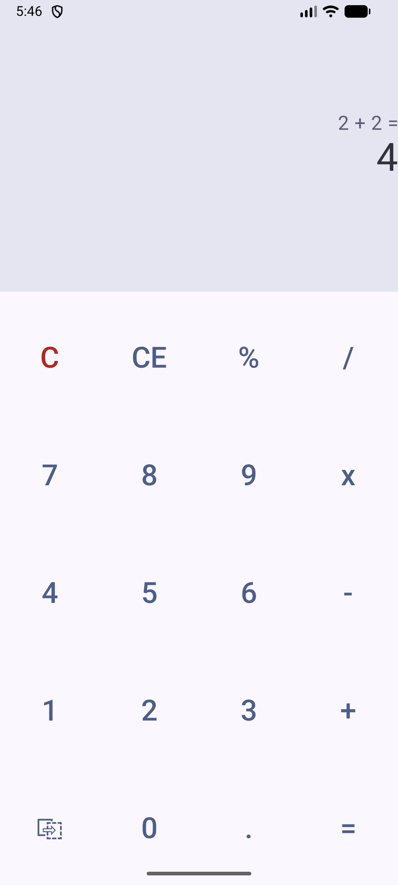
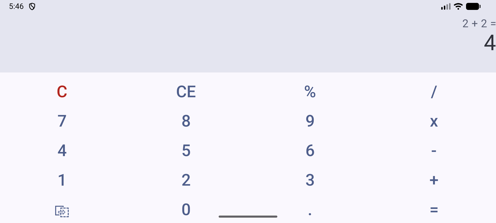

# Калькулятор

Android-калькулятор, который сделан наподобие калькулятора Windows. Написан на Kotlin с использованием Jetpack Compose

## Возможности

- Четыре операции: `+`, `-`, `x`, `/`
- Кнопка `%`
- `C` очищает всё, `CE` стирает только последнее введённое число
- Дробные числа через `.`
- Отрицательное первое число (`-5 + 3 = -2`)
- Кнопка "копирование"
- Защита от деления на ноль

## Запуск

1. Клонировать репозиторий:
   ```
   git clone https://github.com/CallistoCode443/calculator.git
   ```
2. Открыть проект в Android Studio
3. Запустить на эмуляторе или на телефоне, с помощью кнопки Run

## Скриншоты




## Известные ограничения

- Числа хранятся в `Double`, поэтому `0.1 + 0.2` даёт `0.30000000000000004`
- Нет приоритета операций (`2 + 3 x 4` считается как `(2 + 3) x 4`)
- Нет ограничения на длину вводимого числа
